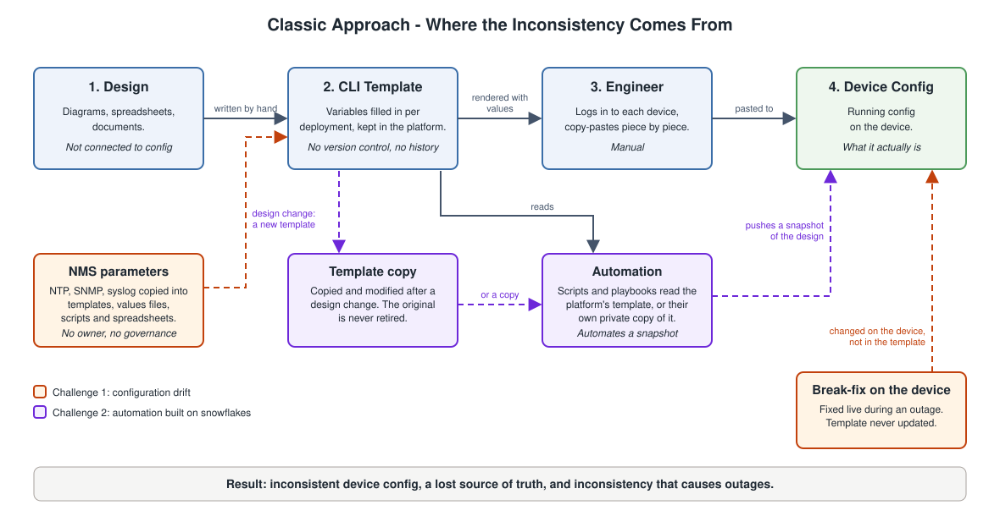

# The Problem - Why Classic Network Configuration Management Drifts

## Classic Approach - How It Works

Classic network configuration management treats the CLI template as the design. The workflow is:

1. Network design is agreed — topology, routing, VLANs, security policy.
2. A CLI template is created from the design. Site-specific values are replaced by variables, such as hostname, IP address, VLAN ID and interface name.
3. Values are filled in per deployment, turning the template into a parameterized template.
4. A network engineer logs in to each device and copy-pastes the rendered configuration, piece by piece.

The baseline part of the template also carries the network management system (NMS) parameters: NTP, SNMP and syslog. These are shared by every device in every environment.

The templates are stored in a classic execution platform. The platform can store and run them, but it has no version control and no capability to track changes. There is no history of who changed what, when and why.

## Challenge 1 - Configuration Drift

The workflow works on day one. The problem is everything after day one.

- **Design changes** — Either the existing template is updated and redeployed, or a new template is created next to the old one. Both leave no clear lineage of which version is the standard.
- **Break-fix changes** — Under outage pressure, the fix is made directly on the device. The template is never updated.
- **Partial rollouts** — A change reaches some devices and not others. Nothing records which ones.

Each action is reasonable on its own. Together they cause configuration drift: the actual device configuration can no longer be correlated with the design.

### Drift in Network Management Parameters

The same drift happens to the network management system (NMS) parameters in the baseline: NTP, SNMP and syslog. They are used by every device, but there is no single location that stores them. They are kept in multiple places: templates, values files, scripts, spreadsheets and the devices themselves.

- **No single location** — The same value is copied into each place that needs it. Nobody can point to the one place that is authoritative.
- **No governance** — When a value changes, there is no review, no approval and no record of who changed it or why.
- **Changes are partial** — A new NTP or syslog server is updated in some places and not others. Devices keep pointing at the old server, and the gap is found only when monitoring or logging stops working.
- **Hard-coded copies hide** — A value typed directly into a template is not visible to anyone updating the values files.
- **Credentials are copied around** — SNMP community strings are stored in plain text in every one of those places.

These parameters have the widest reach of anything in the configuration, and they have no owner and no home.

## Challenge 2 - Automation Built on Snowflakes

Automation is usually added on top of this workflow to remove the copy-paste. The scripts, playbooks and workflows are built from the same unmanaged templates, so they inherit the same weakness.

- **Automates an instance, not the design** — The automation deploys whatever the template contained at the time it was written. It captures a snapshot of the design, not the intent behind it.
- **Consumes templates from wherever they sit** — The automation reads templates from the legacy execution platform, or from its own repository where a private copy was taken. Either way, the templates are disconnected from the design intent. Nothing links them back to the design, so a design change does not reach the automation.
- **Templates are unmanaged** — With no version control and no change tracking, nothing says which template is current, or which devices it was last applied to.
- **Every variation becomes a snowflake** — Site exceptions, break-fix edits and copied-and-modified templates each produce a slightly different result. Automated at scale, the snowflakes are produced faster and in larger numbers.
- **Automation falls out of sync** — When the design changes, the automation has nothing authoritative to follow. It must be manually rebuilt, and in practice it is not.

Automation applied to unmanaged templates does not fix drift. It automates the drift.

## The Real Impact - Inconsistency Causes Outages

Drift is not just untidy configuration, and losing the source of truth is not just a documentation problem. Devices that should be configured the same are not, and inconsistent configuration causes network outages and impact to the business.

- **A change works on some devices and not others** — A device that missed a change behaves differently from its peers. It is the odd one out, and the failure appears when traffic, routing or a failover reaches it.
- **Redundancy fails when it is needed** — A pair or a path is built to be identical. When one side has drifted, the failover that was designed to protect the service is the moment it breaks.
- **A "safe" change is not safe** — Changes are tested and approved against the design. Applied to a device that no longer matches the design, the same change gives a different result.
- **A fix is lost** — A break-fix made on the device is never written back. The next deployment from the template silently removes it, and the original problem returns.
- **Shared parameters fail quietly** — Devices pointing at an old NTP or syslog server lose time sync and logging, and the gap is found only when something else goes wrong.
- **Recovery is slower** — During an outage nobody can say what a device should look like, so troubleshooting starts by finding out what is different.

It also removes the answer to the question "what should this device look like?"

- The template may be stale, because a fix was never written back.
- The device may be the exception, because it missed a change.
- Neither can be proven right, because no history and no intent were recorded.

Once this happens, the source of truth is lost. Audits become manual comparisons, upgrades and migrations carry hidden risk, and "standard" no longer means anything. The inconsistency is invisible until it causes an incident.

The root cause is the model, not the tooling. Both challenges come from the same place: templates and the parameters they depend on are treated as deployment aids rather than as a versioned, governed, authoritative definition of the network. Consistency depends on engineers keeping templates and devices aligned by discipline, and discipline does not scale.
