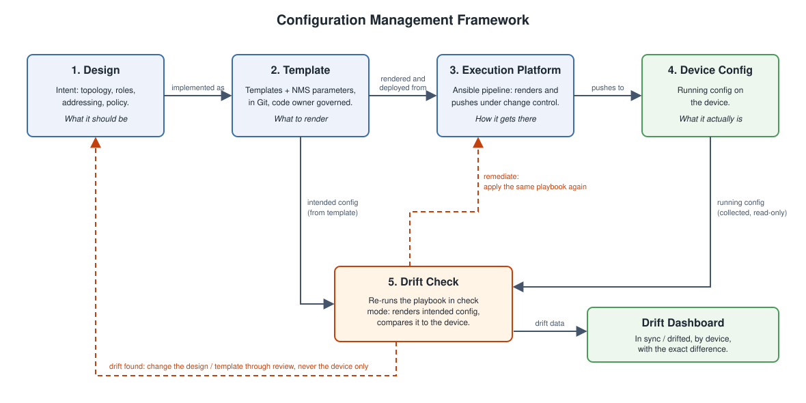

# The Approach - A Configuration Management Framework

## Start With the Framework

The two challenges in [the problem statement](01-the-problem.md) are not tooling problems, so a new tool does not fix them. They come from the relationship between the components. In the classic approach, the design, the template, the execution platform and the device config exist, but nothing keeps them aligned. The approach starts by defining each component and how it relates to the others.

## Components and Relationships

| Component | Role | Question it answers |
|---|---|---|
| **1. Design** | The intent: topology, roles, addressing and policy. | What should the network be? |
| **2. Template** | The design implemented as parameterized config. Split into baseline (per hardware platform) and environment (e.g. Data Center, DMZ). Under version control. | What should be rendered? |
| **3. Execution Platform** | Renders template + values and pushes the result to devices, under change control. | How does it get onto the device? |
| **4. Device Config** | The running configuration on the device. | What is the network actually? |
| **5. Drift Check Script** | Renders the intended config from template + values, collects the running config and compares them. | Do 2 and 4 still agree? |

How they connect:

- **Design → Template** — The template is the design implemented as config. Every template traces back to a design decision.
- **Template → Execution Platform** — The execution platform deploys only from the template. It never holds its own copy.
- **Execution Platform → Device Config** — The push is the only sanctioned way a config reaches a device.
- **Template → Drift Check** — The template, rendered with the device's values, defines the intended config.
- **Device Config → Drift Check** — The running config is collected read-only and compared with the intended config.
- **Drift Check → Execution Platform** — If the device is wrong, remediate by redeploying from the template.
- **Drift Check → Design / Template** — If the device is right and the template is wrong, as with a break-fix that was correct, the change goes back through the design and template, with review. The device is never the place where the change is recorded.

## What Changed Compared to the Classic Approach

- **One direction of authority** — Authority flows Design → Template → Device. In the classic approach the device, the template and the platform could each be changed independently.
- **Drift becomes visible** — The drift check turns "the device config can no longer be correlated with the design" into a line-by-line report, run on demand or on a schedule.
- **Break-fix has a way back** — An emergency change on a device is allowed to happen. It is detected, and either reverted or promoted into the template. It no longer silently becomes the new truth.
- **Templates are managed** — Version control gives each template a history, so "which template is the standard" has one answer.

## Open Points

This framework answers the drift challenge. It reduces, but does not fully answer, the snowflake challenge. Automation still sits on top of templates, and the template is still where intent is encoded by hand. The next content covers how to take the approach further.
