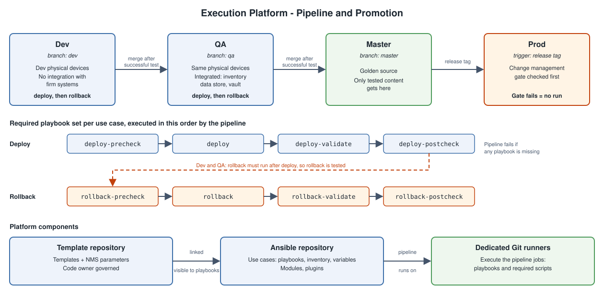

# The Execution Platform - Ansible, Built In-House

## The Choice

The execution platform for this transformation is Ansible. Instead of buying Red Hat Ansible Automation Platform (AAP), the platform is built in-house from Git and Git runners. The classic execution platform stored templates and ran them. The new one does only the second part: templates now live in their own repo, and the platform deploys from them.



## Components

| Component | What it is |
|---|---|
| **Ansible repository** | A Git repo that stores the automation content: playbooks, modules, plugins, inventory and variables. |
| **Dedicated Git runners** | Runners reserved for this platform. They execute the pipeline jobs, which run playbooks or any specific scripts required. |
| **Pipeline** | The only way to execute a playbook. Every run, in every environment, is a pipeline run. |
| **Template repository** | The repo from [templates as code](04-templates-as-code.md). It is linked to the Ansible repo, so the templates and the NMS parameters are visible to the playbooks. |

The link between the two repos is what removes the private-copy problem from [the problem statement](01-the-problem.md). The automation does not carry its own copy of a template. It reads the governed one.

## Playbooks Follow an SDLC

Playbooks are developed the same way as software. A playbook is code, it is tested before it is trusted, and it is promoted through stages.

### Use Case Structure

The repo is organized so that several developers can work at the same time without colliding. Each automation is a **use case**. A use case contains everything it needs: its playbooks, its inventory and its variables.

```text
usecases/
├── <use-case-a>/
│   ├── playbooks/
│   │   ├── deploy-precheck.yml
│   │   ├── deploy.yml
│   │   ├── deploy-postcheck.yml
│   │   ├── deploy-validate.yml
│   │   ├── rollback-precheck.yml
│   │   ├── rollback.yml
│   │   ├── rollback-postcheck.yml
│   │   └── rollback-validate.yml
│   ├── inventory/
│   └── vars/
└── <use-case-b>/
    └── ...
```

Two developers working on two use cases touch different directories, so their changes do not overlap.

### Required Playbook Set

The pipeline enforces that every use case provides a defined set of playbooks, and it runs them in a fixed sequence.

| Phase | Playbooks, in the order they run | Purpose |
|---|---|---|
| **Deploy** | `deploy-precheck` → `deploy` → `deploy-postcheck` → `deploy-validate` | Check the device is ready, make the change, check the change took effect, validate the result. |
| **Rollback** | `rollback-precheck` → `rollback` → `rollback-postcheck` → `rollback-validate` | Same four steps, to undo the change. |

- **Missing playbooks fail the pipeline** — A use case without the full set cannot progress.
- **Rollback is mandatory** — The pipeline requires a rollback to be developed, not just a deploy. Every change ships with a way back.
- **Rollback is tested** — In Dev and QA, the rollback must run after the deploy. A rollback that has never been run is an assumption.

### Pipeline Stages

| Stage | Branch / trigger | Target | Integration with firm systems |
|---|---|---|---|
| **Dev** | `dev` | Dev physical devices | None |
| **QA** | `qa` | The same physical devices | Yes: for example the network inventory data store, and the vault for credentials |
| **Prod** | Release tag | Production | Yes, plus the change management gate |

Dev proves that the playbooks work against real devices, in isolation. QA proves they work with everything around them: inventory data and credentials come from the firm's systems, not from files in the repo.

### Merge Rules and the Golden Source

- **Dev → QA** — A change can merge to `qa` only after successful testing in Dev.
- **QA → Master** — A change can merge to `master` only after successful testing in QA.
- **Master is the golden source** — Only content that has passed both stages is on `master`.

### Production Release

Production deployment is done by creating a **release tag** on `master`. The prod pipeline integrates with the firm's change management system as a control gate. If the change gate check fails, the production run cannot proceed.

## What This Solves

Mapped to the challenges in [the problem statement](01-the-problem.md):

- **Snowflakes** — Automation reads the governed templates and NMS parameters, never a private copy, so it is no longer an instance of a forgotten design.
- **Configuration drift** — Every change to a device comes from the pipeline, from content that is in Git, reviewed and tested.
- **Unsafe changes** — Prechecks, postchecks, validation and a tested rollback surround every deploy. Production is held behind the change gate.

## What Is Still Open

The platform can now deploy reliably. Nothing yet checks whether a device still matches what was deployed. The next content covers the drift check.
