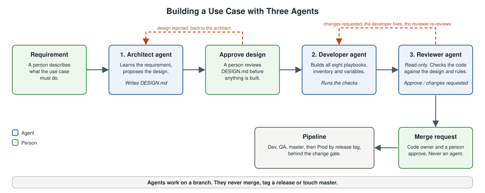

# Add-on - Building Use Cases with Agentic Coding

## Why Agents Fit This Platform

The execution platform is strict about what a use case looks like: eight required playbooks in a fixed order, templates and NMS parameters read from the template repo, an idempotent deploy, and a tested rollback. That structure is what makes it a good fit for agentic coding. The rules are written down, the reference use case exists, and most of the rules can be checked by a script.

This add-on uses Claude in VS Code to build use cases with three agents, each with one job.

## Setup

Claude runs in VS Code through the Claude Code extension. Two things in the Ansible repository give it the platform's rules:

| File | What it gives Claude |
|---|---|
| [`CLAUDE.md`](../examples/execution-platform/ansible-repo/CLAUDE.md) | The conventions every use case follows: the required playbook set, where templates and parameters come from, idempotency, rollback, and the commands to check work. |
| [`.claude/agents/`](../examples/execution-platform/ansible-repo/.claude/agents/) | The three agents, one Markdown file each. |

Both live in the repository. The agents are code under version control, changed by merge request like everything else, so every developer on the team gets the same three agents. In VS Code, open the Ansible repository folder and run `/agents` in Claude to see them.

## The Three Agents

| Agent | Job | Reads | Writes | Tools |
|---|---|---|---|---|
| **[Architect](../examples/execution-platform/ansible-repo/.claude/agents/usecase-architect.md)** | Learns the requirement and proposes how the use case should be designed. | The requirement, `CLAUDE.md`, the reference use case, the template repo | `usecases/<name>/DESIGN.md` only | Read, Glob, Grep, Write |
| **[Developer](../examples/execution-platform/ansible-repo/.claude/agents/usecase-developer.md)** | Builds all the required playbooks, plus inventory and variables, from the approved design. | The approved `DESIGN.md`, the reference use case | `usecases/<name>/` only | Read, Glob, Grep, Write, Edit, Bash |
| **[Code reviewer](../examples/execution-platform/ansible-repo/.claude/agents/usecase-reviewer.md)** | Reviews the code against the design and the platform rules. | The design and the built use case | Nothing | Read, Glob, Grep, Bash |

### Architect

The architect is given a requirement. It reads the platform conventions, the reference use case and the template repo, then writes a design: the requirement and its scope, the templates and parameters the use case reads, a paragraph for each of the eight playbooks, how `deploy` stays idempotent, how rollback works, a Dev and QA test plan, and production considerations. If the design needs a template or parameter that does not exist, it says so, because that is a merge request to the template repo with its own code owner. Open questions go at the top of the design, not into a guess.

[`usecases/ntp/DESIGN.md`](../examples/execution-platform/ansible-repo/usecases/ntp/DESIGN.md) shows the shape of this output for the NTP use case.

### Developer

The developer builds exactly what the approved design says: the eight playbooks, the inventory for each environment, and the variables that point at the template repo. It then proves the work before handing it over, using the platform's own checks (`check_usecase.py`, a full Dev cycle with `run_usecase.sh`, and `review_checks.sh`). If the design is wrong or incomplete it stops and says what has to change. It does not rewrite the design or build something different.

### Code Reviewer

The reviewer has no write tools, on purpose. It runs [`review_checks.sh`](../examples/execution-platform/ansible-repo/scripts/review_checks.sh) first. Those checks are mechanical:

| Check | What it proves |
|---|---|
| Full playbook set present | The pipeline structure gate will pass |
| No hard-coded IP addresses in playbooks | NMS values come from the template repo |
| Deploy is idempotent | A second run changes nothing, so a check-mode run is a valid drift check |
| Dev cycle passes | The deploy phase and the rollback phase both work |

It then reviews the code against a checklist that a script cannot cover: does each playbook do what the design says, can each validate and postcheck actually fail, does the rollback restore exactly what the precheck captured, and does the change touch only what it should. Findings are reported with a file and line, a failure scenario and a severity, ending in **approve** or **changes requested**. The developer fixes and the reviewer reviews again.

## Why Three Agents and Not One

- **Separation of duties** — The agent that builds the code is not the agent that reviews it. The reviewer cannot edit, so it cannot make a problem disappear by fixing it quietly.
- **Focused context** — Each agent holds one job and its own rules. The architect is not tempted to start coding, and the developer is not tempted to redesign.
- **The same logic as the platform** — The platform separates the author of a change from its approver with code owners. The agents separate designing, building and reviewing the same way.

## Agents Follow the Same Governance

An agent is not an exception to anything built earlier in this series:

- **Work happens on a branch.** Agents never merge, tag a release or touch `master`.
- **A person approves the design** before the developer starts, and a person approves the merge request.
- **Templates and NMS parameters are not edited by the agents.** A change to them is a merge request to the template repo, approved by its code owner.
- **The pipeline is unchanged.** Dev, then QA, then `master`, then production by release tag behind the change gate, with the rollback tested in Dev and QA.
- **The agents themselves are governed.** Their definitions and `CLAUDE.md` change by merge request.

Agentic coding speeds up the writing of the use case. It does not change who is allowed to release it.

## What It Does Not Replace

- **The requirement** — A person still decides what the use case should do.
- **Testing on devices** — The pipeline's Dev and QA stages still prove the playbooks against physical devices.
- **Change management** — Production still goes through the change gate.

## What Was Run

The agent definitions, `CLAUDE.md` and the example `DESIGN.md` are in the repository. `review_checks.sh` was run against the NTP use case and all four checks pass. The three agents themselves were not run in VS Code as part of this series, and the NTP playbooks in the worked example were written by hand. The agents are defined to produce the same shape of output.
