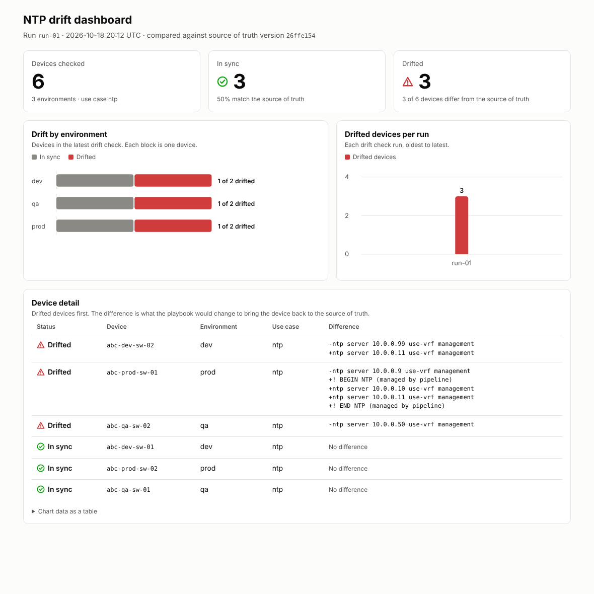
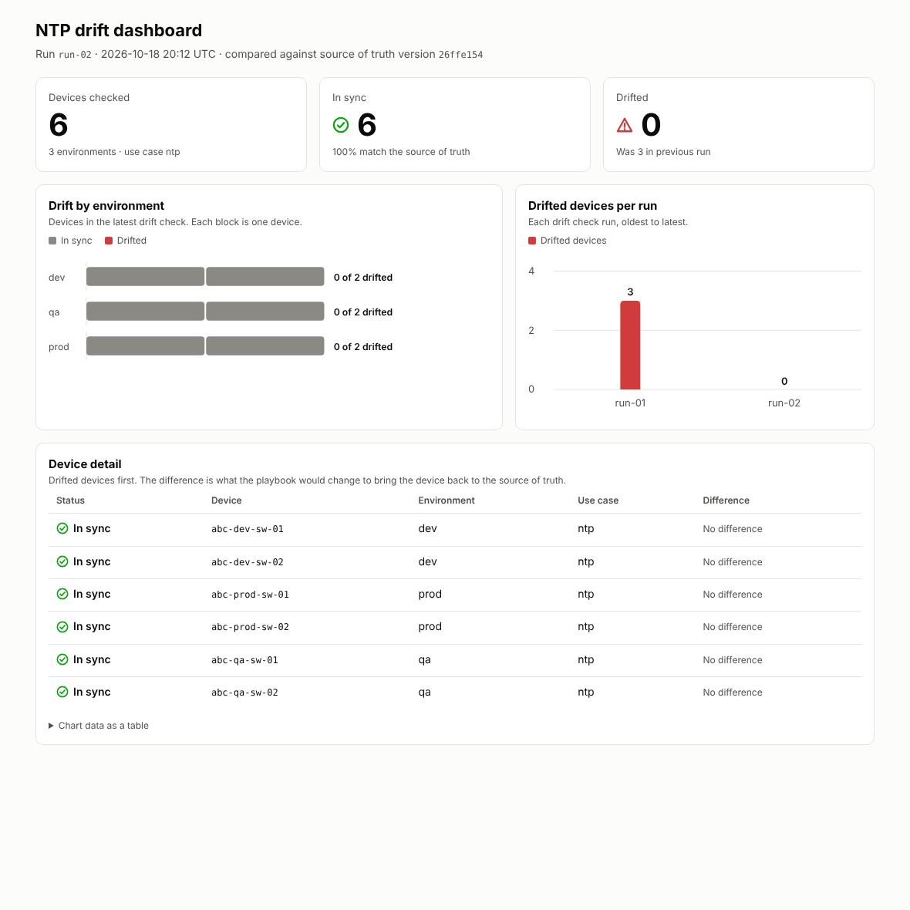

# Execution Platform - Worked Example (NTP Use Case)

A runnable example of the [execution platform](../../docs/05-execution-platform.md) and the [drift check](../../docs/07-drift-check.md), using NTP as the use case. All devices and values are made up. Devices are simulated as config files under `sim/`, so the playbooks run for real with `ansible-core` and no network gear.

## What Is Where

```text
execution-platform/
├── .gitlab-ci.yml                     # pipeline: structure -> dev -> qa -> prod (illustrative, not executed)
├── template-repo/                     # the governed repo from "templates as code", linked in
│   ├── templates/baseline/ntp.j2      #   NTP template
│   ├── parameters/ntp.yml             #   NTP servers: one file, one owner
│   └── CODEOWNERS
├── ansible-repo/
│   ├── ansible.cfg
│   ├── callback_plugins/drift_json.py # records what a check-mode run would change, per host
│   ├── scripts/
│   │   ├── check_usecase.py           # fails the pipeline if the playbook set is incomplete
│   │   ├── run_usecase.sh             # runs the playbooks in the enforced order
│   │   ├── change_gate.py             # STUB for the firm's change management system (prod)
│   │   ├── reset_sim.sh               # puts the simulated devices back to the starting state
│   │   ├── drift_check.sh             # re-runs deploy in check mode, records drift
│   │   ├── drift_record.py            # turns check-mode results into drift records
│   │   ├── remediate.sh               # applies the use case again
│   │   ├── simulate_drift.sh          # builds the drifted starting state for the example
│   │   ├── build_dashboard.py         # drift records -> dashboard HTML
│   │   └── dashboard_template.html
│   └── usecases/ntp/                  # one use case = its playbooks, inventory and variables
│       ├── playbooks/                 #   the eight required playbooks
│       ├── inventory/{dev,qa,prod}/
│       └── vars/main.yml              #   points at the linked template-repo
├── drift/runs/                        # drift records, one file per drift check run
├── dashboard/                         # generated dashboards (HTML and screenshots)
└── sim/{dev,qa,prod}/                 # simulated devices (one config file each)
```

## The Use Case

The use case sets the NTP servers on every device to what is in `template-repo/parameters/ntp.yml`. The devices start with an old server (`10.0.0.9`). `vars/main.yml` points at the template repo:

```yaml
template_repo: "{{ playbook_dir }}/../../../../template-repo"
ntp_template: "{{ template_repo }}/templates/baseline/ntp.j2"
ntp_parameters_file: "{{ template_repo }}/parameters/ntp.yml"
```

The playbook has no copy of the template or the servers. Changing an NTP server is an MR on `parameters/ntp.yml`, approved by its code owner. The pipeline then rolls it out.

| Playbook | What it does in this use case |
|---|---|
| `deploy-precheck` | Asserts the device config exists and NTP servers are defined. Takes a backup so rollback has something to restore. |
| `deploy` | Renders the template and replaces the NTP lines on the device. Idempotent: it reports no change when the device already matches. |
| `deploy-validate` | Straight after the deploy, asserts the device's NTP lines equal the rendered template. |
| `deploy-postcheck` | Asserts nothing else changed: everything except NTP lines equals the backup. |
| `rollback-precheck` | Asserts the backup exists. |
| `rollback` | Restores the backup. |
| `rollback-validate` | Straight after the rollback, asserts the NTP lines are back to the original. |
| `rollback-postcheck` | Asserts the device config is byte-identical to the backup. |

## Run It

```bash
pip install ansible-core
cd ansible-repo
scripts/reset_sim.sh
scripts/run_usecase.sh ntp dev
```

In Dev and QA the script runs the deploy phase and then the rollback phase, as the pipeline enforces. Output from a real run, one recap per playbook (both devices `failed=0`):

```text
=== deploy-precheck (dev)    ok=5 changed=1 failed=0
=== deploy (dev)             ok=5 changed=1 failed=0
=== deploy-validate (dev)    ok=4 changed=0 failed=0
=== deploy-postcheck (dev)   ok=2 changed=0 failed=0
=== rollback-precheck (dev)  ok=2 changed=0 failed=0
=== rollback (dev)           ok=1 changed=1 failed=0
=== rollback-validate (dev)  ok=2 changed=0 failed=0
=== rollback-postcheck (dev) ok=1 changed=0 failed=0
```

After the deploy phase the device has the servers from the template repo. After the rollback phase it is back to `10.0.0.9`, so rollback is proven to work before anything reaches `master`.

Production runs the deploy phase only:

```bash
scripts/run_usecase.sh ntp prod
```

```text
hostname abc-prod-sw-01
feature ssh
! BEGIN NTP (managed by pipeline)
ntp server 10.0.0.10 use-vrf management
ntp server 10.0.0.11 use-vrf management
! END NTP (managed by pipeline)
logging server 10.0.0.20 use-vrf management
snmp-server community EXAMPLE-ONLY ro
```

## The Pipeline Enforces the Rules

`.gitlab-ci.yml` maps the stages onto branches and the tag. It was not executed here, because there is no GitLab runner in this example. It parses as valid YAML, and the scripts it calls were run directly.

| Stage | Trigger | What the job does |
|---|---|---|
| `structure` | Any branch or tag | `check_usecase.py` on every use case |
| `dev` | Branch `dev` | `run_usecase.sh <use case> dev`: deploy phase, then rollback phase |
| `qa` | Branch `qa` | Fetches inventory and credentials from firm systems (stubs), then deploy phase and rollback phase |
| `prod` | Release tag | `change_gate.py` first, then the deploy phase only |

**Incomplete playbook set fails the pipeline.** With `rollback.yml` removed:

```text
FAIL ntp: missing rollback
```

**Change gate blocks production.** The gate here is a stub that passes only when `CHANGE_APPROVED=true`:

```text
CHANGE GATE FAILED: change 'none' is not approved. Production run blocked.
CHANGE GATE PASSED: CHG0012345
```

**Validate catches a device that does not match the template repo.** Someone edits an NTP server on `abc-dev-sw-01` after the deploy, and `deploy-validate` fails on that device only:

```text
fatal: [abc-dev-sw-01]: FAILED! ... "NTP on abc-dev-sw-01 does not match the template repo"
```

## What Is Simulated

- **Devices** are config files. The playbooks edit them with `lineinfile` and `blockinfile`. Real devices would use the vendor's Ansible collection, with the same playbook structure.
- **Change gate, inventory data store and vault** are stubs.
- **The pipeline file** is illustrative and not run.
- **The link to the template repo** is a folder next to the Ansible repo here. In the pipeline it is a checkout of the template repo before any job runs.

## Drift Check, Dashboard and Remediation

The deploy playbook was built from the source of truth and is idempotent, so running it again in **check mode** (`--check --diff`) changes nothing and reports what it *would* change. For a device, "would change something" is drift. A small callback plugin (`callback_plugins/drift_json.py`) records that per device, and `drift_check.sh` turns it into a drift record.

### Starting State

`scripts/simulate_drift.sh` deploys NTP to all six devices from the source of truth, then makes three things happen that the source of truth does not know about:

| Device | What happened |
|---|---|
| `abc-dev-sw-02` | Someone edited an NTP server by hand (`10.0.0.11` became `10.0.0.99`). |
| `abc-qa-sw-02` | An extra NTP server `10.0.0.50` was added during a break-fix. |
| `abc-prod-sw-01` | Missed by the rollout. It still has the old server `10.0.0.9`. |

### 1. Drift Check

```bash
cd ansible-repo
scripts/simulate_drift.sh
for env in dev qa prod; do scripts/drift_check.sh ntp $env run-01; done
```

```text
run-01 dev:  abc-dev-sw-01=in sync, abc-dev-sw-02=drifted
run-01 qa:   abc-qa-sw-01=in sync, abc-qa-sw-02=drifted
run-01 prod: abc-prod-sw-01=drifted, abc-prod-sw-02=in sync
```

Each record in `drift/runs/run-01.json` has the device, environment, use case, result and the difference. For `abc-dev-sw-02`:

```json
{"device": "abc-dev-sw-02", "environment": "dev", "use_case": "ntp", "result": "drifted",
 "difference": ["-ntp server 10.0.0.99 use-vrf management", "+ntp server 10.0.0.11 use-vrf management"]}
```

The run also records the version of the source of truth the devices were compared against. Here that is a content hash of the template and parameter files. The real platform would record the commit or release tag.

### 2. Dashboard

```bash
python3 scripts/build_dashboard.py ../dashboard/index.html
```



The dashboard is one self-contained HTML file: `dashboard/drift-dashboard-before.html`. It shows:

- **Tiles** — Devices checked, in sync and drifted.
- **Drift by environment** — One block per device, with drifted devices highlighted.
- **Drifted devices per run** — The trend across drift check runs.
- **Device detail** — Drifted devices first, each with the exact difference. A "Chart data as a table" section repeats the chart values as text.

### 3. Remediation

Remediation is the same use case applied again, through the same prechecks, validation and postchecks. No separate tooling:

```bash
for env in dev qa prod; do scripts/remediate.sh ntp $env; done
```

`remediate.sh` runs the deploy phase only. Dev and QA normally also run the rollback phase to test it. Remediation does not need that, because the rollback was already tested before the use case reached `master`. In production the same run would be behind the change gate.

### 4. Drift Check Again

```bash
for env in dev qa prod; do scripts/drift_check.sh ntp $env run-02; done
python3 scripts/build_dashboard.py ../dashboard/index.html
```



All six devices are in sync and the per-run chart shows drift going from 3 devices to 0. The generated files are in `drift/runs/` and `dashboard/`. Open `dashboard/index.html` in a browser; add `?theme=dark` to the address for the dark theme.

### What Is Simulated

- **Devices** are config files, as in the rest of this example.
- **The drift check is run by hand.** In the real platform it is a scheduled pipeline run, and the dashboard reads the records the pipeline stores.
- **This example covers one use case.** The dashboard's use case column and per-environment view are there for when more use cases are added.
